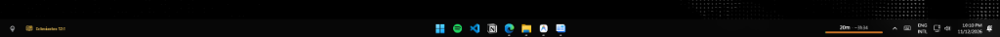
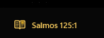
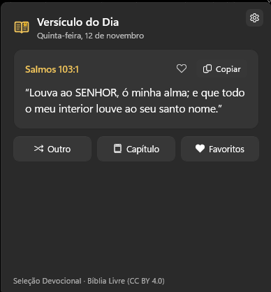
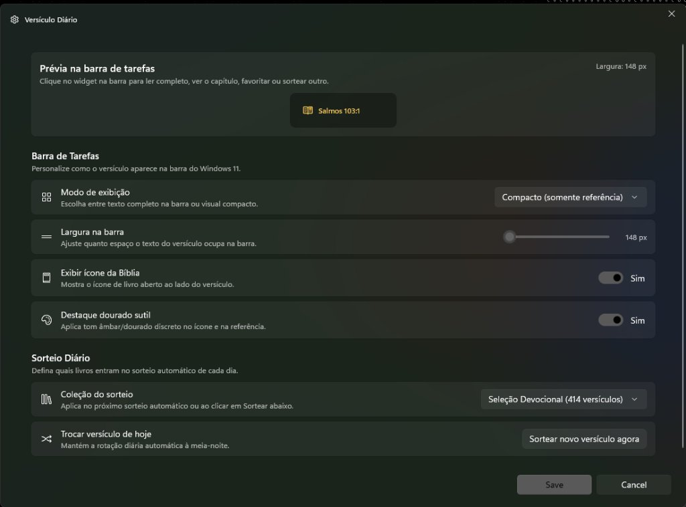

# Versículo Diário — Widget para WidBar (Windows 11)

Widget nativo do Windows 11 para o **[WidBar](https://github.com/andelby/widbar)** (`WidBar.SDK` 2.3 + WinUI 3 + .NET 8) que exibe diariamente um versículo bíblico aleatório direto na barra de tarefas.

## Capturas de tela

### Na barra de tarefas




### Flyout (versículo, capítulo e favoritos)


### Configurações com prévia ao vivo


## Recursos

- **Troca diária automática**: sorteia um novo versículo aleatório por dia (na virada da meia-noite ou ao voltar da suspensão) e mantém o mesmo durante todo o dia, com histórico anti-repetição de até 365 versículos persistido em `SharedDataDirectory`.
- **100% offline e texto completo**: embute todos os **66 livros e 31.102 versículos** da **Bíblia Livre** (`por_blj`, CC BY 4.0) em `biblia-livre.tsv.gz` (~1,3 MB), sem depender de internet ou chaves de API.
- **4 coleções de sorteio**:
  - **Seleção Devocional** *(padrão)*: 366+ versículos edificantes selecionados em toda a Bíblia (evitando trechos isolados ou genealogias).
  - **Salmos, Provérbios e Novo Testamento**
  - **Bíblia Completa** (todos os 66 livros)
  - **Meus Favoritos**
- **Integração visual nativa com o Windows 11**:
  - Fundo raiz transparente (compatível com estilos translúcidos do **Windhawk** / *Taskbar Styler*).
  - Adaptação automática a **temas Claro e Escuro** e a **barra de tarefas normal ou pequena**.
  - 4 modos de exibição na barra (*Referência + Versículo*, *Somente Versículo*, *Somente Referência* e *Somente Ícone*) com largura ajustável (`180`–`460 px`).
- **Flyout completo e Tile para Widget Board**:
  - Leitor do **capítulo inteiro em contexto** com navegação entre capítulos e destaque no versículo do dia.
  - Botão **Outro** para sortear outro versículo na hora, cópia para a área de transferência em 1 clique e gerenciamento de **Favoritos**.

---

## Pré-requisitos para instalar

1. **Windows 11** com **[WidBar](https://apps.microsoft.com/search?query=WidBar)** instalado (Microsoft Store).
2. **Modo de Desenvolvedor** ativado no Windows (*Configurações → Sistema → Para desenvolvedores → Modo de desenvolvedor*).
3. **[.NET 8 SDK](https://dotnet.microsoft.com/download/dotnet/8.0)** (`x64`).
4. **Windows 10/11 SDK** (necessário apenas pela ferramenta `makepri.exe` usada no empacotamento local).

## Instalação rápida (PowerShell)

```powershell
git clone https://github.com/victormrreis/widbar-daily-verse.git
cd widbar-daily-verse

# Compila, gera o resources.pri e registra a extensão no Windows/WidBar
.\tools\Deploy-Local.ps1
```

Após concluir o script:
1. Abra o **WidBar** e vá até a aba **Layout** (se já estiver aberta, clique em **Atualizar / Refresh**).
2. Arraste **Versículo Diário** para o espaço desejado na barra de tarefas.
3. Clique no widget para abrir o painel completo ou na engrenagem para personalizar largura, tema dourado, modo compacto e coleção de sorteio.

---

## Estrutura do projeto

- `src/WidBar.DailyVerse.Core/` — Modelos, repositório bíblico comprimido (`Data/biblia-livre.tsv.gz`), seleção devocional curada (`Data/CuratedVerses.cs`), persistência atômica e `DailyVerseCoordinator`.
- `src/WidBar.DailyVerse.ExtensionApp/` — Extensão WinUI 3 + `WidBar.SDK` (`MainPlugin`, `TaskbarPreviewControl`, `VerseFlyoutView`, `VerseSettingsView`, `BibleIconView`).
- `tests/WidBar.DailyVerse.Tests/` — Testes unitários em xUnit validando integridade dos 31.102 versículos, referências curadas, rotação diária com `TimeProvider` e configurações.
- `tools/New-PackageIcons.ps1` — Gera os ícones PNG em todas as escalas do pacote MSIX.
- `tools/Deploy-Local.ps1` — Publica (`win-x64` self-contained), gera `resources.pri` e registra o layout em Modo Desenvolvedor (`Add-AppxPackage -Register`).

## Testes

```powershell
dotnet test tests\WidBar.DailyVerse.Tests\WidBar.DailyVerse.Tests.csproj -c Release
```

## Créditos e Licenças

- Código do widget licenciado sob a [Licença MIT](LICENSE).
- Texto bíblico: **Bíblia Livre** (© 2018 Diego Santos, Mario Sérgio, Marco Teles) — distribuída sob licença **CC BY 4.0**.
- Construído sobre o **[WidBar SDK](https://github.com/andelby/widbar-widget-template)**.
